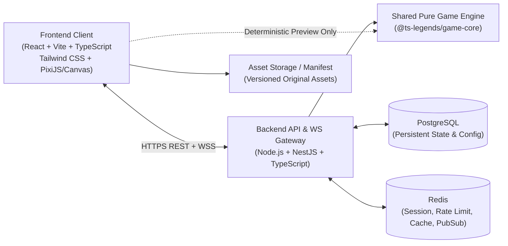

# ARCHITECTURE PROPOSAL — TS LEGENDS: IDLE RPG

**Version:** 1.0 (Phase 1 Gate Deliverable)  
**Target Platforms:** Web Browser, Windows PC (PWA/Electron-ready), Android & iOS (Responsive Web / Capacitor-ready)  
**Architecture Style:** Server-Authoritative, Data-Driven Monorepo

---

## 1. High-Level System Architecture



---

## 2. Monorepo Directory Structure

```text
TS-Idle-Project/
├── packages/
│   ├── shared-types/       # Shared DTOs, API contracts, Error codes
│   └── game-core/          # Pure TS: Stat formulas, Turn-based combat, Idle calc, Element matrix
├── apps/
│   ├── api/                # NestJS Backend (REST + WebSocket + Auth + Admin + Seeders)
│   └── web/                # React + Vite + Tailwind + 2D Isometric/RPG Battle Canvas
├── data/
│   ├── raw/                # Verified Phase 1 snapshots (read-only reference)
│   └── seed/               # Normalized JSON/SQL seeds + game_configurations
├── docs/
│   └── phase1/             # Source Data Audit & Reports
└── docker-compose.yml      # PostgreSQL 16 + Redis 7 + API + Web + Nginx
```

---

## 3. Core Architectural Decisions

1. **Server-Authoritative Combat & Progression:**
   - Client **ห้าม** คำนวณ EXP, Currency, Drop, หรือผลแพ้ชนะของการต่อสู้เอง
   - Client ส่ง Action (เช่น Claim Idle Rewards, Challenge Stage, Enter Boss Raid) -> Server โหลด `game_configurations` + `player_characters` -> รัน `@ts-legends/game-core` -> บันทึกผลลง PostgreSQL ภายใต้ Database Transaction (`SERIALIZABLE` / Row Lock ป้องกัน Duplicate Claim)
2. **Data-Driven Configuration (`game_configurations`):**
   - สูตรคำนวณ Stats (`HP`, `ATK`, `DEF`, `MATK`, `MDEF`, `SPD`, `CRIT`, `HIT`, `EVA`), EXP Curve, Drop Rates, Idle Time Cap (เช่น 12 ชั่วโมง), และ Combat Balance อยู่ใน Database ปรับผ่าน Admin Panel ได้ทันทีโดยไม่ต้อง Rebuild Client
3. **Database & Caching:**
   - **PostgreSQL:** Primary source of truth สำหรับผู้เล่น, ขุนพล, ไอเทม, เควส, กิลด์, และ Audit Logs
   - **Redis:** Session/Refresh Token Blacklist, API Rate Limiting, Leaderboard (`ZSET`), และ Real-time Chat/Boss Raid PubSub
4. **2D RPG Perspective & Original UI/UX:**
   - ใช้ React + Tailwind CSS สำหรับ UI 20 หน้าจอสไตล์ Chinese Fantasy Idle RPG (รองรับ Desktop/Tablet/Mobile + TH/EN)
   - ใช้ HTML5 Canvas / PixiJS สำหรับฉากต่อสู้ 2D Isometric/Turn-Based Auto Battle พร้อม Original Vector/Sprite Placeholders และ Animation
5. **Security Baseline:**
   - JWT Access Token (Short-lived) + HttpOnly/Rotated Refresh Token
   - Idempotency Keys / DB Constraints ป้องกัน Replay Attack และ Duplicate Reward Claim
   - Role-Based Access Control (RBAC: `PLAYER`, `MODERATOR`, `ADMIN`)
